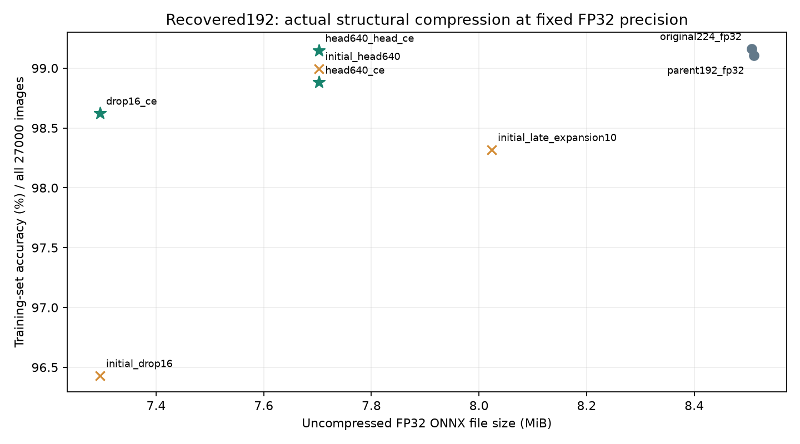

# Reduce recovered192 size while keeping FP32

The team requested actual parameter/file reduction at identical FP32 precision. The original224 reference is 8.506 MiB and recovered192 reference is 8.511 MiB. All new weights, checkpoints and ONNX computations remain FP32. New recovery uses the RTX 3070 with AMP disabled; laptop inference remains CPU-only. Older FP16 artifacts and evidence remain preserved.

**Every new candidate is evaluated on all 27,000 images.** No 500-image model selection is used in this series. This is the organizer all-data training-set protocol, not held-out accuracy. All exports retain `(1,3,224,224)` input and `(1,10)` output.

| Model / stage | Parameters | FP32 MiB | Accuracy / 27,000 | Worst class recall |
|---|---:|---:|---:|---:|
| Original student / FP32 | 2,236,682 | 8.506295 | 99.1630% | 95.84% |
| Recovered192 reference / FP32 | 2,236,682 | 8.510991 | 99.1074% | 97.24% |
| Late expansion channels / before recovery | 2,108,202 | 8.023564 | 98.3185% | 96.12% |
| Final 640 channels / before recovery | 2,024,202 | 7.702886 | 98.9963% | 97.40% |
| Residual block 16 removed / before recovery | 1,916,682 | 7.295685 | 96.4296% | 87.80% |
| Final 640 / full-backbone recovery | 2,024,202 | 7.702886 | 98.8815% | 97.65% |
| Remove block 16 / full-backbone recovery | 1,916,682 | 7.295685 | 98.6222% | 95.53% |
| Final 640 / classifier-only recovery | 2,024,202 | 7.702886 | 99.1481% | 97.40% |

## What each edit does

- **Late expansion pruning:** remove 10% of hidden channels, aligned to eight, only in blocks 14–17. Preserve all early features, bottleneck outputs and residual widths. Rank BN-scaled projection-column norms and physically slice expansion, depthwise and projection tensors.
- **Final feature reduction:** remove 640 of the final 1,280 feature channels, with dependent BN/classifier inputs sliced consistently. Rank BN-scaled classifier-column norms.
- **Residual block removal:** replace feature block 16 with Identity. This block has matching input/output width and stride one, so the tensor contract remains valid. Its learned transformations and all their parameters are physically absent.

These are structural edits, not zero masks. Exact removed channel indices are saved in recipe.json. A judge recreates the architecture from the supplied student, applies recorded edits, and loads the saved FP32 state. All three initial models passed exact recipe/state replay and PyTorch-to-ONNX parity checks. [Torch-Pruning dependency handling](https://github.com/VainF/Torch-Pruning).

## Recovery and measurement

Initial accuracy is measured before retraining. Recover the two promising size tradeoffs (head640 and drop16) for one epoch each of full-backbone CE recovery, then test classifier-only recovery from the initial head640 model on all 27,000 images, with BN running statistics frozen. The exported result is evaluated again on all 27,000. Model hashes link scores to files. Isolated, serial four-thread ONNX benchmarks compare original224, unpruned recovered192 and the chosen feature-layer version and recovered block-removal version at FP32; no training runs concurrently. CodeCarbon provides CPU/RAM estimates, not meter readings.

| Matched FP32 runtime | Median ms | Estimated J/inference (mean ± SD) | Repetitions |
|---|---:|---:|---:|
| original224_fp32 | 2.5321 | 0.052934 ± 0.001388 | 3 |
| parent192_fp32 | 1.9662 | 0.041391 ± 0.000984 | 3 |
| head640_head_ce | 1.9791 | 0.040847 ± 0.000989 | 3 |
| drop16_ce | 1.8932 | 0.039281 ± 0.000442 | 3 |

The classifier-recovered 640-channel model reduces median latency by 21.8% and estimated energy per inference by 22.8% versus original224 in this matched sequence. Relative to unpruned recovered192, its latency ratio is 1.007 and energy ratio is 0.987. Small differences within run variability do not establish further acceleration from feature pruning.

Timing uses one real preprocessed image, repeated 1,000 times after 100 warmups per process. The accuracy column comes from the separate complete 27,000-image evaluation. Energy uses three 30-second CPU/RAM CodeCarbon windows, with GPU excluded. Compare energy estimates on this laptop only; these do not measure physical edge-device joules.


## Selected FP32 model

**Classifier-only recovery of the 640-channel model is the balanced selection.** Its 7.703 MiB FP32 ONNX is 9.4% smaller than original224 and 9.5% smaller than unpruned recovered192, using actual parameter removal. It scores 99.1481% on all 27,000 training-pool images and 97.40% worst-class recall. It gets four fewer images correct than original224, and eleven more than recovered192. [Saved weights and recipe](../best_models/resize192_head640_head_ce_fp32_8655a532a076/README.md).

Recovery started from the initial head640 pruning result. Train only 6,410 classifier parameters for one GPU FP32 epoch at learning rate 1e-4, batch 32, seed 42, using every image. Backbone tensors and BN running statistics stay identical to the initial pruned model; only classifier weight and bias change. Training took 37.06 seconds. This restores overall accuracy from 98.9963% to 99.1481%.

A separate full-backbone epoch at learning rate 5e-5 took 53.54 seconds but reduced head640 accuracy to 98.8815%; keep that negative result. The block-removal recovery took 52.32 seconds and improved 96.4296% to 98.6222%, with a larger 14.3% size reduction and lower worst-class recall of 95.53%. The saved selection favors the better accuracy and class balance. Older winners remain preserved.


## Further ways to explore

1. **Gradual or data-aware channel pruning:** remove fewer channels per step, recover between steps, or use loss sensitivity over the full training pool to rank removals. Compare gains with the extra optimization time.
2. **Low-rank factorization of large 1x1 convolutions:** replace a dense matrix with two lower-rank FP32 matrices. This can preserve feature widths while reducing parameters, but adds an operation and needs a measured latency check plus recovery.
3. **Teacher-assisted recovery:** distill the structurally smaller network from recovered192 or the supplied ResNet50 if hard-label recovery loses too much accuracy. Distillation alone does not shrink a fixed architecture. [PyTorch distillation tutorial](https://docs.pytorch.org/tutorials/beginner/knowledge_distillation_tutorial.html).

Dense unstructured zero masks still store the same number of FP32 values. Lower spatial resolution alone changes computation but not weight count. ZIP/download compression is separate from the deployed FP32 model footprint.

## Reproduce

```powershell
.venv\Scripts\python.exe scripts/fp32_structural_screen.py build
.venv\Scripts\python.exe scripts/fp32_structural_screen.py evaluate
.venv-train-gpu\Scripts\python.exe -m edgeprep.challenge recover --recipe artifacts/fp32_compression/head640/recipe.json --output artifacts/fp32_compression/head640_head_ce --head-only --epochs 1 --train-limit 0 --device cuda --no-amp --workers 2 --batch-size 32 --lr 1e-4
.venv\Scripts\python.exe -m edgeprep.challenge export --recipe artifacts/fp32_compression/head640_head_ce/recipe.json --output artifacts/fp32_compression/head640_head_ce_export
.venv\Scripts\python.exe -m edgeprep.challenge evaluate --model artifacts/fp32_compression/head640_head_ce_export/model_fp32.onnx --limit 0 --threads 4 --output results/fp32_compression/head640_head_ce_accuracy.json
```

For the two full-backbone recovery trials, use the initial head640 or drop16 recipe, omit --head-only, set --lr 5e-5 and choose a separate output folder. Export and evaluate each using the CPU commands above. Exact training indices, state hashes, history and GPU settings are stored in each recipe and the numbered experiment details. Matched runtime is reproduced with scripts/fp32_runtime_compare.py and the two saved candidate paths.

Build reconstructs from the public saved FP32 recovered_state.pt in the preserved winner bundle. Obtain the original organizer checkpoint under Models/ as described in the main README. Downloaded data, routine intermediate models and environments remain local. [Summary evidence](../results/fp32_compression/summary.json).



