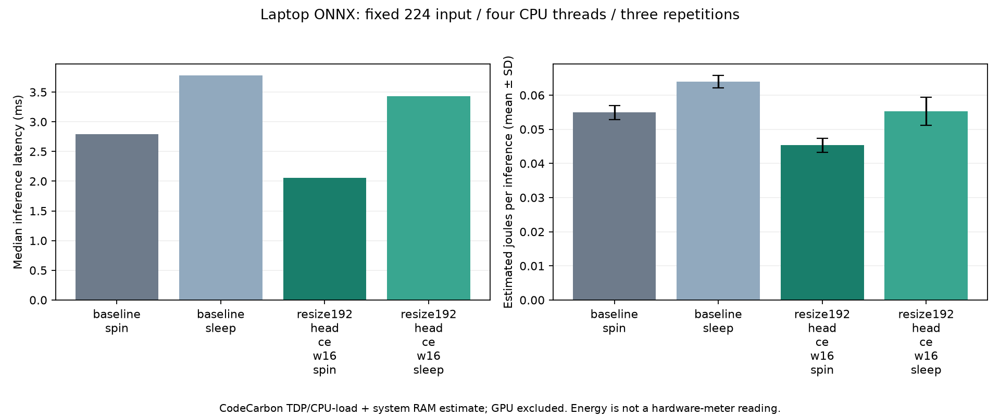

# Next priorities: live execution and results

The PDF specifies no device model: section 2 asks teams to use a common AI Hub target if possible and permits laptop fallback. Until the organizers designate one, our primary reference remains the Ryzen 7 5800H laptop. Remote device results are exploratory, with separate references.

| Target | Why | Comparison |
|---|---|---|
| Samsung Galaxy S24 (Family), Snapdragon 8 Gen 3 | Practical phone CPU/NPU kernels; successful existing deployments | Same unchanged source on CPU vs ONNX/QNN NPU; family scheduling does not guarantee the same physical unit |
| Dragonwing RB3 Gen 2 Vision Kit, QCS6490 | Embedded vision hardware and quantized NPU route | Same-device W8A8 vs W8A16, ONNX/QNN; retain failed QNN DLC as a negative result |
| Our laptop CPU | PDF's matched energy and runtime reference | Full 27k labelled accuracy; fresh serial baseline/candidate latency and CodeCarbon estimate |

We avoid proxy catalogue entries for physical-board claims. S24 floating execution may use NPU reduced precision; `precision=none` means no explicit Hub quantization, not proof of full FP32 arithmetic. Device/profile OS and actual per-layer placement are saved.

## Bigger labelled remote evaluation

The new diagnostic subset has **1,000 images, 100 per class**, seed 20261013, and excludes the exact 512 calibration indices. It remains a subset of the organizer's all-data training/evaluation pool; it is not held-out generalization. Its balanced accuracy can differ from frequency-weighted full-data accuracy.

`edgeprep/hub_accuracy.py` saves image indices, ordering hash, labels, exact preprocessing, per-shard hashes and local FP32 logits. Four reusable 250-image uploads are shared between targets. Inference job IDs are saved immediately and collection is resumable. `dataset_accuracy.json` contains actual label-based accuracy, every class recall, worst recall, confusion matrix, and source-logit agreement separately. Partial shard results never become a final 1,000-image score.

```powershell
# Prepare once. Do not overwrite the subset while jobs are running.
.venv\Scripts\python.exe -m edgeprep.hub_accuracy prepare
# Reuses existing successful compiled models and uploaded datasets.
.venv\Scripts\python.exe -m edgeprep.hub_accuracy submit --folder results/hub/s24_cpu_fp32 --folder results/hub/s24_npu_float_retry --folder results/hub/rb3_onnx_npu_w8a8
# Collect currently successful shards without blocking on pending jobs.
.venv\Scripts\python.exe -m edgeprep.hub_accuracy collect --folder results/hub/s24_cpu_fp32 --folder results/hub/s24_npu_float_retry --folder results/hub/rb3_onnx_npu_w8a8
```

AI Hub uploads expire after 30 days; saved dataset IDs are reuse hints, not permanent copies. Inputs remain locally reproducible from the manifest and original EuroSAT files. Downloaded arrays and API credentials are excluded from Git.

## Smaller weight storage with CPU-compatible computation

A separate candidate rounds exported weights to FP16 storage and adds explicit Cast-to-FP32 nodes. ONNX Runtime folds these constant casts at load time: the saved optimized graph has zero Cast nodes and all floating initializers are FP32. This keeps FP32 CPU convolution while reducing the portable file to 4.288 MiB. It does not reduce learned parameter count or prove a RAM saving. It also rounds weights, so full-data accuracy must be checked independently.

Reproduction after classifier recovery/export:

```powershell
.venv\Scripts\python.exe -m edgeprep.weight_storage --source artifacts/all_data/resize192_head_ce/model_fp32.onnx --output artifacts/all_data/resize192_head_ce_w16
.venv\Scripts\python.exe -m edgeprep.challenge evaluate --model artifacts/all_data/resize192_head_ce_w16/model_weight16.onnx --threads 4 --output results/all_data/resize192_head_ce_w16_accuracy.json
```

Implementation: `edgeprep/weight_storage.py`. Evidence: `results/all_data/resize192_head_ce_w16_storage.json`. [ONNX Cast specification](https://onnx.ai/onnx/operators/onnx__Cast.html), [ORT constant folding](https://onnxruntime.ai/docs/performance/model-optimizations/graph-optimizations.html).

## Reducing latency and estimated energy

The matched thread sweep measures identical FP32 weights at 1/2/4/8 CPU threads in three repetitions. Exported ONNX internal-resize variants use 192 or 160 spatial pixels while retaining the fixed external `(1,3,224,224)` input and ten-class output. PDF section 3 explicitly allows resolution optimization under that external contract. No weights are retrained; parameter count and weight file size are essentially unchanged. Resize interpolation is bilinear, align_corners=False, antialias=False. Full-data accuracy is necessary before selecting either variant.

```powershell
.venv\Scripts\python.exe -m edgeprep.resolution --size 192 --output artifacts/all_data/resize192
.venv\Scripts\python.exe -m edgeprep.challenge evaluate --model artifacts/all_data/resize192/model_fp32.onnx --threads 4 --output results/all_data/resize192_accuracy.json
```

The PDF's energy tool is CodeCarbon. [Measurement setup and limitations](energy_measurement.md) distinguish our Windows TDP estimate from hardware-meter energy. NPU burst/balanced/power_saver profiles test runtime behavior; none proves a remote energy saving on its own.

New results are appended below after the jobs complete. See [the sequential log](../experiments/README.md) for combined tables and linked implementation.

## Completed measurements

### All-data accuracy

Training-set accuracy on identical 27,000 indices; no held-out generalization claim.

| Candidate | Accuracy | Worst class recall | Change vs original |
|---|---:|---:|---:|
| baseline | 99.1630% | 95.8400% | +0.0000 pp |
| resize192 | 98.0000% | 93.8000% | -1.1630 pp |
| resize160 | 93.0037% | 78.0500% | -6.1593 pp |
| resize192_head_ce | 99.1074% | 97.2400% | -0.0556 pp |
| resize192_head_ce_w16 | 99.1111% | 97.2400% | -0.0519 pp |

Classifier recovery: one epoch, 27,000 training images, batch 32, LR 0.0001, 12,810 trained head parameters. Backbone weights/BN buffers unchanged: True. Runtime 540.9 seconds. No teacher or augmentation.

### Latest matched model/runtime measurements

Three fresh serial repetitions, four threads, 100 warmups, 1,000 timings and 30-second energy windows. Energy is a TDP/load CPU + RAM heuristic estimate.

| Scenario | Median latency | Estimated J/inference (mean ± sample SD) | Latency ratio | Energy ratio |
|---|---:|---:|---:|---:|
| baseline_spin | 2.7892 ms | 0.054927 ± 0.002059 | 1.000 | 1.000 |
| baseline_sleep | 3.7828 ms | 0.064004 ± 0.001806 | 1.356 | 1.165 |
| resize192_head_ce_w16_spin | 2.0538 ms | 0.045338 ± 0.002045 | 0.736 | 0.825 |
| resize192_head_ce_w16_sleep | 3.4335 ms | 0.055279 ± 0.004107 | 1.231 | 1.006 |

Reference is unchanged FP32 with default spinning, freshly remeasured in the same sequence. Sleeping-worker gains require explicit ORT session settings and may trade latency for CPU work. The ONNX file alone does not force judge thread options. Repetition ranges retain OS/thermal variation.




### Direct 192 latency comparison

Separate fresh rotating-order sequence; four CPU threads, default spinning, five repetitions. Use this sequence for comparisons between FP32 and FP16-storage recovered models; do not mix its baseline with older timings.

| Model | Median latency | Range of run medians | P95 | Ratio to matched 224 |
|---|---:|---:|---:|---:|
| baseline | 4.8931 ms | 2.6362–5.3630 ms | 8.2112 ms | 1.000 |
| resize192 | 2.2218 ms | 1.9647–3.6117 ms | 5.5810 ms | 0.454 |
| resize192_head_ce | 2.1075 ms | 1.8651–4.2736 ms | 4.7433 ms | 0.431 |
| resize192_head_ce_w16 | 2.1788 ms | 1.8374–3.8339 ms | 4.8588 ms | 0.445 |

FP16 weights are cast/folded to FP32 on CPU. Small latency differences do not establish FP16 compute acceleration. All repetitions, including noisy results, are retained.

### GPU training verification

Separate `.venv-train-gpu` / NVIDIA GeForce RTX 3070 Laptop GPU / PyTorch 2.8.0+cu128. CUDA AMP full-backbone training: 100 real images, 5 steps, 8.18 seconds. CPU export and CPU inference passed. This is a pipeline smoke test; it does not replace the selected all-data result. Future training defaults to CUDA without silent CPU fallback. AI Hub CPU/NPU remains independent of the laptop inference rule. [Setup and recipe](gpu_training.md).

### Labelled device accuracy

Original224 runs use 1,000 balanced images (100/class); saved192 runs use a separate 500-image sample (50/class). Both exclude the 512 calibration images and remain diagnostic training-pool accuracy. Compare source hashes and sample counts; do not rank accuracy across different samples.

| Run | Device | Mode | Internal size | Images | Hub latency | Labelled accuracy | Worst recall |
|---|---|---|---:|---:|---:|---:|---:|
| rb3_onnx_npu_w8a16 | Dragonwing RB3 Gen 2 Vision Kit | burst | 224 | 1000 | 1.056 ms | 98.50% | 88.0% |
| rb3_onnx_npu_w8a8 | Dragonwing RB3 Gen 2 Vision Kit | burst | 224 | 1000 | 0.614 ms | 98.30% | 89.0% |
| rb3_onnx_npu_w8a8_balanced | Dragonwing RB3 Gen 2 Vision Kit | balanced | 224 | 1000 | 0.648 ms | 98.30% (same artifact; burst accuracy) | 89.0% |
| rb3_onnx_npu_w8a8_power_saver | Dragonwing RB3 Gen 2 Vision Kit | power_saver | 224 | 1000 | 0.680 ms | 98.30% (same artifact; burst accuracy) | 89.0% |
| resize192_s24_cpu | Samsung Galaxy S24 | burst | 192 | 500 | 4.183 ms | 99.40% | 96.0% |
| resize192_s24_npu | Samsung Galaxy S24 | burst | 192 | 500 | 0.435 ms | 99.40% | 96.0% |
| s24_cpu_fp32 | Samsung Galaxy S24 (Family) | burst | 224 | 1000 | 5.533 ms | 98.80% | 90.0% |
| s24_npu_float_retry | Samsung Galaxy S24 (Family) | burst | 224 | 1000 | 0.366 ms | 98.80% | 90.0% |
| s24_npu_float_retry_balanced | Samsung Galaxy S24 (Family) | balanced | 224 | 1000 | 0.778 ms | 98.80% (same artifact; burst accuracy) | 90.0% |
| s24_npu_float_retry_power_saver | Samsung Galaxy S24 (Family) | power_saver | 224 | 1000 | 1.192 ms | 98.80% (same artifact; burst accuracy) | 90.0% |

Remote power modes report latency/memory, not joules. S24 family routing may use different physical units. RB3 W8A8/W8A16 are a same-target precision comparison. Inspect actual operation placement and retain failed DLC jobs.
